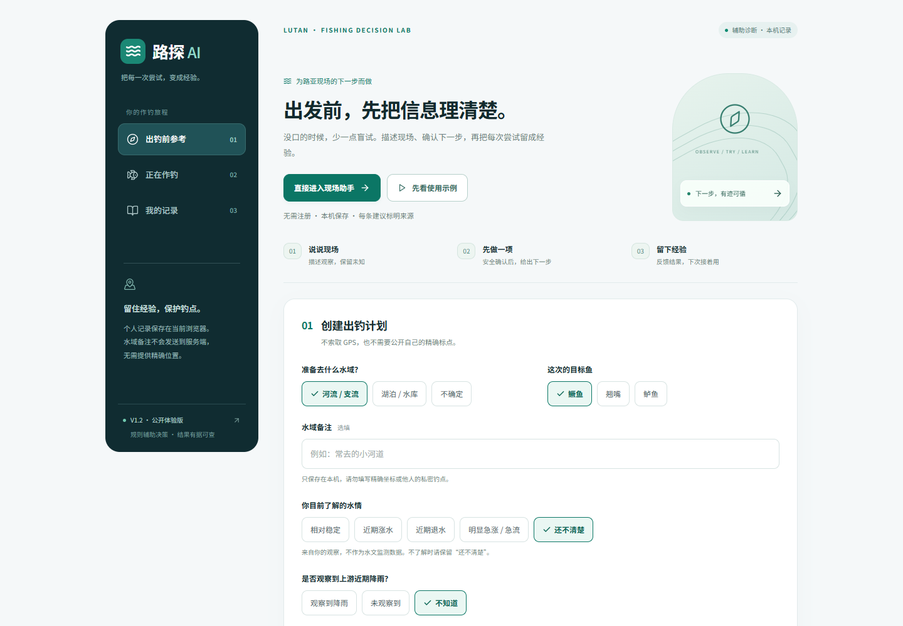
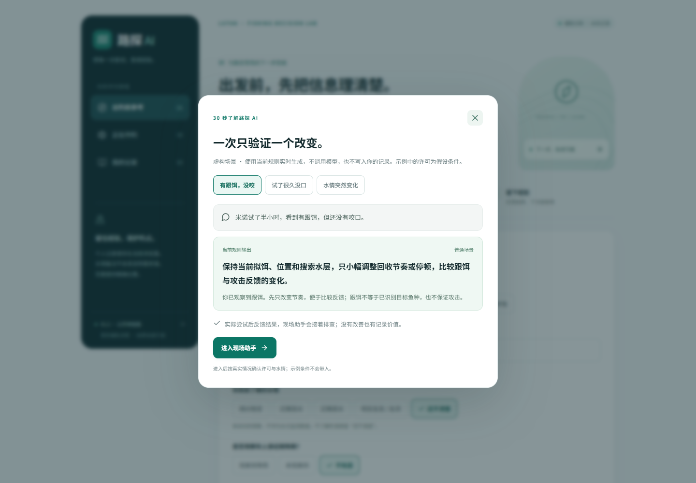

# 路探 AI

**没口的时候，先把下一步想清楚。**

一个面向淡水路亚现场的决策助手：描述看到的情况，获得一项可验证的行动，反馈尝试结果，把经验留到下一次。

[GitHub 源码](https://github.com/Joshua-ran/lutan-ai) · [在线体验](https://lutan-ai-field-assistant.jazzy-snow-2518.chatgpt.site) · [真实 DeepSeek 联调记录](docs/FOLLOWUP_FIX.md) · [模型与功能说明](docs/V1.2_AGENT.md)



## 可以怎么用

- **出钓前**：整理水域、目标与许可信息，分清已知和待核实项。
- **正在作钓**：用文字描述现场，可附一张照片；助手先补充缺失信息，再给出一项行动。实际尝试后继续反馈，避免反复推荐已经失败的方向。原有三步表单也可以使用。
- **我的记录**：恢复会话、复用条件、筛选和导出记录。数据保存在当前浏览器，无需注册。

第一次打开可以点击“先看使用示例”。示例使用虚构场景与当前规则，不调用模型，不写入个人历史，也不会把示例的许可条件带入真实使用。



## 作品重点

路探 AI 把“给一个回答”做成了“观察 → 单项尝试 → 反馈 → 继续排查”的流程。三个页面串起准备、现场与复盘，桌面与手机均可使用。

技术栈为 **React / TypeScript / Vite / Express / Zod**。前后端共用规则与 Schema，模型通过服务端适配器接入。安全水情、禁钓和许可未知先由规则处理，不进入模型；普通场景才允许模型在限定依据与行动范围内辅助解释。输出校验失败、超时或额度不足时，结果明确标注为规则回退。

本地生产环境仍由 Express 同时提供页面和 API；在线托管增加轻量传输适配，共用同一套业务服务。在线模型调用使用持久化共享计数器，数据库仅保存日期与次数，个人会话仍保存在浏览器。


## 本地启动

需要 Node.js 22.12+。

```sh
npm ci
npm run dev
```

打开 http://127.0.0.1:5173。Windows 也可以双击 `Start-LutanAI.cmd`。不配置密钥即可使用规则与本机记录。

接入自己的 DeepSeek：参考 [.env.deepseek.example](.env.deepseek.example)，在本机 `.env` 或服务端环境设置以下内容后重启。密钥只放服务端。

```dotenv
LLM_ENABLED=true
LLM_PROVIDER=deepseek
LLM_MODEL=deepseek-flash
DEEPSEEK_API_KEY=
LLM_MAX_OUTPUT_TOKENS=1024
```

生产环境运行 `npm run build`、`npm start`，默认地址 http://127.0.0.1:8787；容器或云服务通过 `HOST=0.0.0.0` 与 `PORT` 配置监听。在线域名与本机地址的浏览器记录相互独立。

开发检查：`npm run typecheck`、`npm test`、`npm run evaluate`、`npm run test:e2e`。常规自动测试使用模拟模型，不产生真实模型费用；真实联调需显式启用。

早期需求、原型与研究材料保留在项目中，详细实现说明位于 `docs/`。公开演示和合成用例均不代表真实用户反馈或实钓效果。
