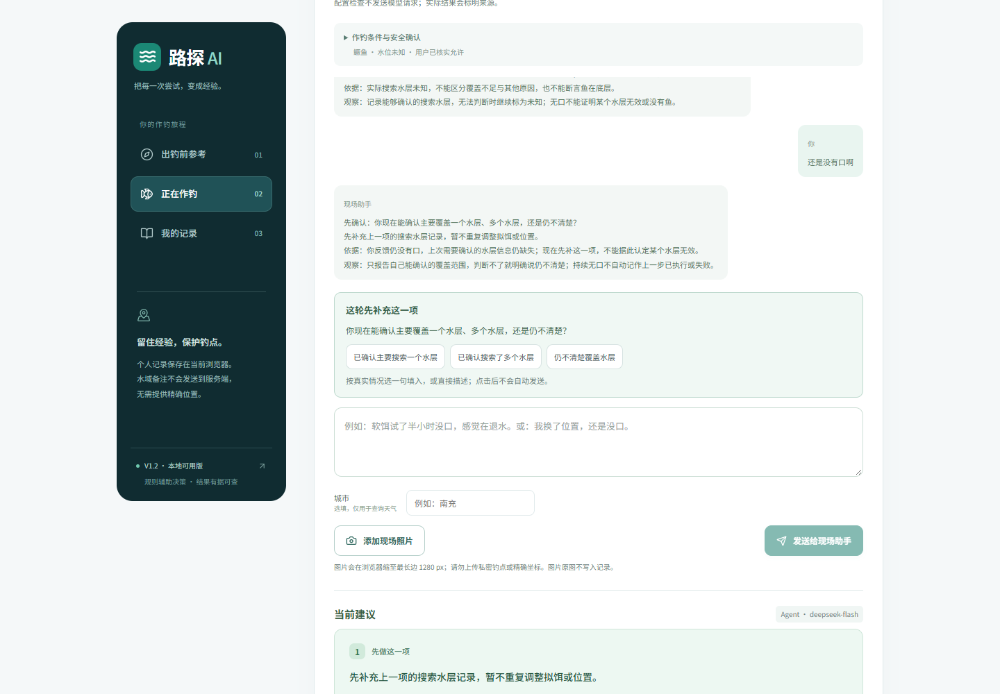

# V1.2 连续追问复读修复

日期：2026-11-16。针对“还是没有口啊”后原样返回水层确认建议的问题，已修复反馈识别、后续决策和追问展示。真实 DeepSeek 连续四轮及浏览器验证通过；这些输入是合成联调条件，不是实钓反馈或渔获改善证据。

## 原因

原反馈匹配识别“还是没口”，漏掉了“还是没有口啊”。模型虽然收到历史消息，规则候选仍只依据旧的“水层未知”状态生成，导致继续选同一条初始动作。必要追问又放在输入框下方的结果详情中，聊天消息没有带出问题；聊天区也未自动滚到最新消息。

仅仅让模型换一种说法不能解决这个问题。本次增加了明确的对话进度处理，保留既有安全和事实边界。

## 当前行为

- “还是没有口”“仍然没有鱼口”等会识别为持续无口。没有明确实际执行过时，不擅自把上一项记成失败，不补造执行时间。
- 上一步需要的信息仍缺失时，先提出一个具体追问，不复读初始动作。追问放在输入框旁边，聊天回复也带出问题。
- “一个水层 / 多个水层 / 仍不清楚”等回复选项只填入草稿，由用户按实际情况选择并发送。明确补充的水层、拟饵会进入下一轮条件；未知仍保留未知。
- 明确说已尝试且没有改善后，使用本次会话记录选取另一个尚未失败的单变量方向，模型不能继续选已失败的同方向动作。
- 信息确认不再以鱼口是否改善作为成功标准。用户说已尝试但还不能判断结果时，只记录已尝试，不强记成功或失败。
- 去掉产品预填的“试了 20 分钟”，文字报告没有给出的实际执行时间保持未知。
- 新消息和会话恢复会定位到聊天区最新回复；已有历史记录和存储 Schema 保持兼容。

安全、禁钓、许可未知仍在模型调用前拦截；连续追问不能绕过门控。离线/无模型时，规则回退也会提出必要追问。

## 真实 DeepSeek 四轮结果

通过本机 Chrome + Playwright 操作真实前端，没有使用路由伪造或回放 API 响应。仅在合成测试假设中显式确认允许，用于隔离普通模型路径。

| 轮次 | 合成输入 | 实际处理 | 接口耗时 |
| --- | --- | --- | --- |
| 1 | 软饵试了半小时没口，覆盖水层不清楚 | 确认覆盖水层，并提出追问 | 2160 ms |
| 2 | 还是没有口啊 | 明确问一个水层、多个水层或仍不清楚；未把上一项记成已尝试或失败 | 2063 ms |
| 3 | 已确认主要搜索一个水层 | 条件更新后，给出只比较另一搜索水层的动作 | 1842 ms |
| 4 | 按你说的试过了，还是没有口啊 | 保留没有改善的反馈，改为单项钓组检查，不重复变水层 | 1553 ms |

四轮返回来源均为 `agent`、模型为 `deepseek-flash`，每轮报告一次模型请求。此次没有执行会话或天气工具，不把随请求提供的会话快照说成工具成功。刷新后最后结果和来源可恢复。

[四轮原始记录](verification/followup-live-browser.json) 保留输入快照、基础规则结果、连续会话规则回退结果、实际接口输出、来源、调用次数和耗时。执行时间、真实鱼种和鱼口原因没有被补造；“试过”的声明只是合成输入。

## 实际检查

| 命令/检查 | 结果 |
| --- | --- |
| `npm run typecheck` | 通过 |
| `npm test` | 85 项通过 |
| `npm run test:e2e` | 完整 34 项通过，含桌面与手机的精确复现语句 |
| `npm run evaluate` | 23 PASS / 0 FAIL / 1 NEEDS_REVIEW；P02 仍待接入历史物种资料 |
| `npm run build` | 成功；有原第三方 Zod 注释位置警告 |
| 原五场景双入口真实回归 | 最终 10 项通过；普通分支实际请求，危险/未知许可仍零调用 |

[最终五场景原始记录](verification/live-deepseek/run-20261116T125023929Z.json)。另保留了 [此前同组回归](verification/live-deepseek/run-20261116T124710153Z.json)；两次各 6 个真实模型请求，加四轮对话，本次受控检查共 16 次。此计数不包含用户自主使用，也不是账户账单总请求数。

默认自动浏览器套件中的供应商与天气仍为模拟；真实四轮和真实五场景证据独立存档，不把模拟结果当真实模型质量。真实照片、在线天气和实钓效果仍未验收，复杂口语识别仍需更多真实场景检查。

## 修改文件

| 文件 | 内容 |
| --- | --- |
| `shared/agent.ts` | 扩展口语反馈识别，区分是否尝试，避免虚构时间或成功归因 |
| `shared/agent-followup.ts` | 缺失信息、待确认结果、持续无口的具体追问 |
| `shared/agent-fallback.ts` | 用户明确条件归入下一轮，离线回退也遵守同一进度 |
| `server/agent/grounding.ts`、`service.ts` | 后续追问与下一动作契约、失败方向约束及模型输入 |
| `src/components/AgentAssistant.tsx`、`src/styles.css` | 显眼追问、真实回复选项、聊天自动滚动，移除伪造时长 |
| `tests/agent-followup.test.ts`、既有 Agent 测试、`tests/e2e/agent-followup.spec.ts` | 精确语句与三轮推进、明确失败后的不同动作、安全优先和界面回归 |

## 现在怎么继续

刷新原会话，回答输入框上方的“这轮先补充这一项”。按实际情况选择覆盖一个水层、多个水层或仍不清楚，然后发送。没有实际尝试时如实说未尝试；实际试过无改善时再明确说明，不需要为了得到不同回复编造条件。

[手机展示](../delivery/assets/mobile-followup-latest-fixed.png)。截图用同一条已保存的真实回复恢复会话，验证最新消息定位与追问位置，没有额外发模型请求。
