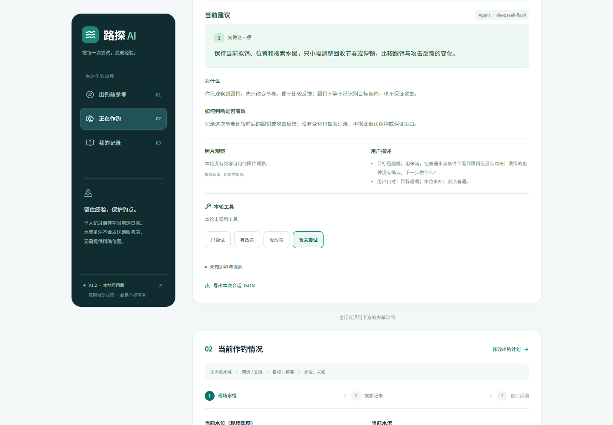

# 路探 AI V1.2 · 真实 DeepSeek 五场景联调记录

本文保留初次联调阶段记录。后续已修复首次使用的许可提示与默认缺失信息分支，并再次运行五场景；当前说明和最新原始记录见 [首次使用修复](USABILITY_FIX.md)。下表耗时与 17 次请求计数属于初次联调阶段。

执行日期：2026-11-16。当前已完成真实 DeepSeek **文字业务接口**联调，模型实际返回 `deepseek-flash`；新版现场助手和原表单均已跑通。输入来自原始合成场景，不是真实钓友、实钓或鱼获效果数据。

## 最终结果

同一组五个场景分别经过两个真实 HTTP 业务入口，共 10 项检查。普通场景在本轮的假设条件中设为“用户自述已核验允许”；这只用于隔离模型路径，不代表系统核验了任何实际河段许可。

| 场景 | 新版现场助手 | 原表单诊断 | 本轮 API 耗时（助手 / 表单） |
| --- | --- | --- | --- |
| D03 跟饵 | 真实 AI，1 次供应商请求；只比较节奏 | 真实 AI，1 次供应商请求；规则候选选择 | 2067 / 781 ms |
| D04 疑似触碰 | 真实 AI，1 次供应商请求；只检查钓组，不确认鱼口 | 真实 AI，1 次供应商请求；规则候选选择 | 1330 / 909 ms |
| D06 充分尝试无口 | 真实 AI，1 次供应商请求；结束当前标点重复搜索 | 真实 AI，1 次供应商请求；规则候选选择 | 1550 / 908 ms |
| D01 危险水情 | 规则撤离提示，供应商请求 0 | 规则撤离提示，供应商请求 0 | 2 / 2 ms |
| P05 合法性未知 | 先核实许可，供应商请求 0 | 先核实许可，供应商请求 0 | 3 / 2 ms |

最终这轮 6 次供应商请求均实际发往 DeepSeek 官方 HTTPS 服务并返回 HTTP 200，公开响应中的模型字段均为 `deepseek-flash`。来源不是只依据本机配置猜测：记录包含真实响应 ID、公开回复、供应商模型字段、token 用量及耗时。表中是本轮单次测量，不能据此承诺今后的速度或稳定性。

最终记录：[五场景双入口原始 JSON](verification/live-deepseek/run-20261116T111746128Z.json)。每一项都保存合成输入、规范化输入、规则原始结果、接口最终结果、实际模型公开输出或门控结果、模型来源、调用次数和时间。原始 24 场景文件未改写。

## 首轮发现的问题和修复

首轮网络和结构检查均能通过，但开发侧逐条阅读发现新版自由生成不满足事实边界：

- D03 自行补出了“近岸 5–10 米”，还使用“犹豫”“触发开口”等未获输入支持的解释。
- D04 未优先执行钩尖/钓组检查，追加拖底、挑竿、刺鱼等多步动作，并对触碰作了过强判断。
- D06 在充分尝试后又建议换位、找结构和用饵搜索，混入多项行动。

这些首轮回复保留为问题证据，不列为质量通过。原表单的可信候选选择没有出现这些问题。

修复后，对 `retrieve_rhythm`、`check_rig`、`end_spot` 三类分支增加服务端决策契约：**动作从已审查的同方向候选中选择，依据和检查方法必须与规则原句一致，未知项只能引用给定边界**。模型改变方向、增加距离或事实、改写检查方法时，整条回到规则，不放宽校验。已有“没有改善”的方向仍交给会话比较逻辑处理，不能强制重复。

这意味着这三类场景当前采用的是“规则限定范围内的模型选择”，不应把最终文案当成 DeepSeek 独立发现的钓鱼规律。其他普通图文分支保留原有受限生成和失败回退；它们仍需要后续真实场景验收。

相关文件：`server/agent/grounding.ts`、`server/agent/service.ts`、`tests/agent-grounding.test.ts`。安全、禁钓与许可未知的先后顺序没有改变。

## 页面中的真实调用

另用 Playwright + Chrome，通过正在运行的前端页面发送合成 D03 描述；没有用路由伪造或回放结果。实际经过 Vite 代理、Express 和 DeepSeek，页面显示 `Agent · deepseek-flash`，来源为 `agent`，供应商请求 1 次。刷新后保留相同结果和来源，切换到手机尺寸后无横向溢出，无控制台错误。

这次正确初始化的浏览器提交耗时 2246 ms；手机检查复用同一条真实回复，没有再消耗模型请求。[页面真实调用记录](verification/live-deepseek/browser-real-api.json)。截图保存在本机验收产物目录，不包含真实密钥或现场照片。



[查看同一条真实回复的手机展示](../delivery/assets/v1.2-real-deepseek-mobile.png)。

最初一次浏览器检查在应用已运行时直接注入测试存储，导致内存中的目标鱼与测试消息不一致；该记录单独保留，排除出 D03 条件一致性验收。改为页面初始化前种入测试会话，并补查目标鱼与拟饵一致后重跑通过。这是测试准备问题，没有将旧记录伪装为最终验收。

## 记录索引与真实请求数

| 记录 | 用途 | 实际供应商请求 |
| --- | --- | --- |
| [D03 初次连接](verification/live-deepseek/run-20261116T111228846Z.json) | 两个入口可达；新版回复有待修复的事实问题 | 2 |
| [首轮五场景](verification/live-deepseek/run-20261116T111245518Z.json) | 发现上述自由生成质量问题；D06 实际触发会话工具 | 7 |
| [修复后五场景](verification/live-deepseek/run-20261116T111746128Z.json) | 本次采纳的五场景技术验收 | 6 |
| [浏览器初次准备](verification/live-deepseek/browser-initial-setup.json) | 测试条件不一致，排除出场景验收 | 1 |
| [浏览器最终验收](verification/live-deepseek/browser-real-api.json) | 实际页面提交、来源显示、刷新恢复及手机展示 | 1 |

本轮累计 17 次真实模型请求，初次和失败质量结果均保留；没有在后台自动重试。最终五场景验收只统计上表第三项的 10 个业务检查，不把 17 次请求解释成 17 个实钓场景。[复核索引](verification/live-deepseek/acceptance.json) 标明采纳和排除的记录、代码哈希和复核范围。复核由 Codex 完成，不等同钓鱼专家或真实用户评测。

## 回归、配置与复现

本轮实际执行：`npm run typecheck` 通过；`npm test` 77 项通过；`npm run test:e2e` 28 项通过（自动浏览器套件中的模型与天气仍为模拟）；`npm run evaluate` 仍为 23 PASS / 0 FAIL / 1 NEEDS_REVIEW；`npm run build` 成功。P02 的历史物种资料接入仍未完成。

当前本机已启用服务端 DeepSeek 配置。换机器使用自己的密钥时，参考 [.env.deepseek.example](../.env.deepseek.example) 和 [演示指南](DEMO_GUIDE.md)；模板不含密钥，默认不消耗模型额度。`npm run doctor` 只检查配置字段，不发推理请求，所以其“本次未验证推理”标记不代表没有历史联调记录。

需要再次明确使用自己的额度时执行：

```powershell
npm run test:live -- --allow-paid --surface both
```

该命令只允许已批准的五个场景，结果写入新的 `docs/verification/live-deepseek/run-*.json`，不覆盖已有原始记录，不进入默认自动测试。密钥、鉴权头、原图及模型思考原文不写入结果。供应商失败、超时或校验失败会真实记录并使用原规则回退，不把回退标成 AI 成功。

请求使用官方 Chat Completions 协议和现有 DeepSeek 预设，协议说明见 [DeepSeek Chat Completions](https://api-docs.deepseek.com/api/create-chat-completion/) 与 [JSON Output](https://api-docs.deepseek.com/guides/json_mode/)。

尚未验收：真实照片理解、在线天气质量、长期多轮表现、真实钓友使用及实钓效果。当前结果只能证明这五个合成场景的真实文字 API 链路和规则边界通过了本次检查。
