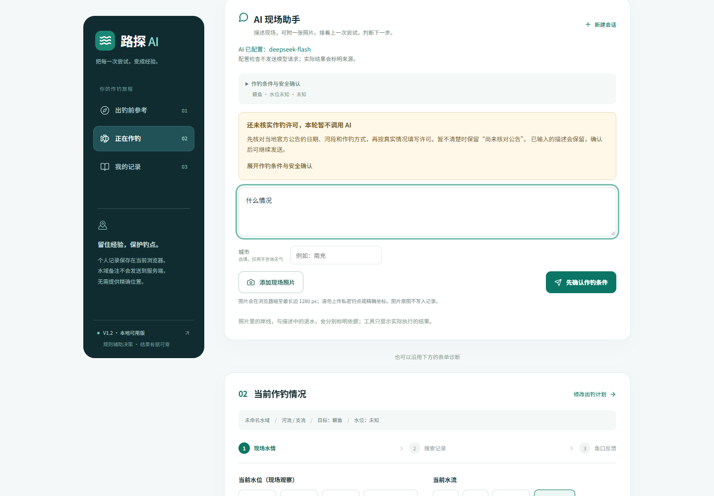

# V1.2 首次使用与许可提示修复

日期：2026-11-16。针对用户截图中反复出现同一条许可提示、误以为 API 未接入的问题完成局部修复。当前 DeepSeek 已配置且真实请求成功；截图中的“合法性未知”使原流程在模型调用前返回规则。

后续又修复了普通条件下的连续追问复读，最新四轮真实记录与 85 项单元/API、34 项浏览器检查见 [连续对话修复](FOLLOWUP_FIX.md)。本文保留首次使用问题的阶段记录。

## 用户现在会看到什么

- 页面明确区分“AI 已配置”和“本轮因什么条件暂不调用”。配置检查只读取本机健康接口，不消耗模型额度，也不声称已经完成当前供应商连通性探测。
- 许可未知时显示原因和“展开作钓条件与安全确认”。发送按钮显示“先确认作钓条件”，点击后展开条件、保留草稿和照片，不重复写入同一条安全回复，也不发送模型或图片请求。
- 只有用户按真实情况确认允许当前方式作钓、且没有报告危险或禁钓时，按钮才恢复“发送给现场助手”。没有自动勾选允许，也没有降低安全、禁钓、许可未知的优先级。
- 用户显式修改的条件会保存，刷新后仍能恢复。旧会话中的安全提示标为“安全规则 · 本次未调用 AI”，不再把安全提醒当成可评价是否改善鱼口的动作。
- 草稿文字报告急流、急涨或禁钓时，也会在发送前拦截，并清楚显示对应原因。

## 怎么使用

刷新当前应用，进入“正在作钓”。许可仍未知时点击“先确认作钓条件”或提示中的展开按钮。**只有确已核对适用公告的日期、河段与作钓方式，并确认允许时，才选择“已核对公告，允许当前方式”**；无法核实时保留未知。

填写真实的现场描述后发送。模型成功返回时显示 `Agent · deepseek-flash`；未配置、服务失败或输出不合格时保留明确的规则来源和原因。

## 修改文件

| 文件 | 变化 |
| --- | --- |
| `src/components/AgentAssistant.tsx` | 配置状态、可见门控提示、展开条件、草稿保留、避免重复回复、显式条件保存与安全结果来源 |
| `src/lib/agent-api.ts` | 只读本机模型配置检查，Zod 校验与超时处理，不向模型发探测请求 |
| `src/styles.css` | 沿用现有界面的状态文字和提示卡样式 |
| `server/agent/grounding.ts` | 将缺少拟饵/搜索水层的两类分支也纳入规则候选，禁止凭无口宣称某水层无效 |
| `tests/agent-availability.test.ts`、`tests/agent-grounding.test.ts` | 公开配置状态、隐私、结构和缺失信息分支的回归 |
| `tests/e2e/agent-gate.spec.ts`、`tests/e2e/agent.spec.ts` | 首次使用、旧会话兼容、未知/危险零调用、确认后正常发送及工具闭环 |

本机历史记录沿用原存储键和 Schema，没有删除或重写已有记录。

## 真实执行证据

使用本机 Chrome + Playwright，当前会话没有 Browser 插件。真实页面从默认“未知”开始，输入“什么情况”，验证草稿保留、条件展开、没有自动选中允许、没有模型请求、没有重复聊天记录。随后在**合成联调假设**中显式选择已核验允许，发送“软饵试了半小时没口，实际覆盖的水层还不清楚。下一步先做什么？”。没有伪造或回放 HTTP 响应，DeepSeek 实际返回成功，接口耗时 1544 ms、返回来源 `agent`、模型 `deepseek-flash`、模型请求 1 次。刷新后仍保留许可状态与结果。

手机 390×844 和桌面 1440×1000 均检查了未知许可的引导，没有横向溢出或控制台错误；手机验证没有另发付费请求。[浏览器原始记录](verification/gate-usability-browser.json)。

最初一条真实回复曾对水层作出过度判断，原始记录保留在 [初次回复](verification/gate-usability-browser-first.json)，不计为内容质量通过。新增两类候选契约后重跑，最终回复明确保留未知，不把无口解释成水层无效。

五场景随后又经过两个真实 API 入口复核，共 10 项检查通过。三个普通场景总计 6 次供应商 HTTP 请求均返回 200，危险与许可未知场景均为 0。[最新五场景原始记录](verification/live-deepseek/run-20261116T114932739Z.json)。首轮 API 联调历史见 [原联调报告](LIVE_API_REPORT.md)。本轮修复与复核新增 8 次真实模型请求，其中包含保留的首条质量问题回复；没有后台自动重试。

实际执行：`npm run typecheck` 通过，`npm test` 79 项通过；`npm run test:e2e` 完整 30 项通过，随后新增旧会话用例的桌面/手机两项定向检查通过；`npm run evaluate` 为 23 PASS / 0 FAIL / 1 NEEDS_REVIEW；`npm run build` 成功。默认自动测试里的模型与天气仍为模拟，真实页面和真实五场景证据单独存档。

## 界面证据

本机已配置 DeepSeek 时的首次使用示例；许可未知仍不调用模型。

[手机提示界面](../delivery/assets/mobile-gate-unknown-fixed.png)。真实照片理解、在线天气、实钓效果和其他未覆盖生成分支仍需后续验收。
